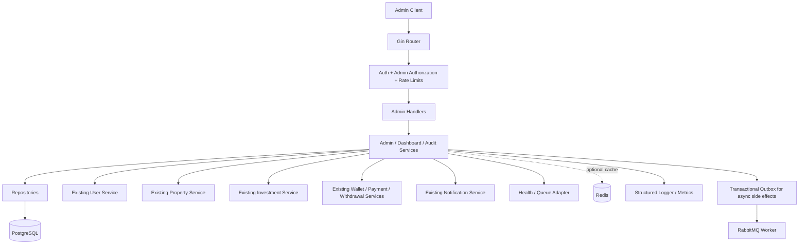
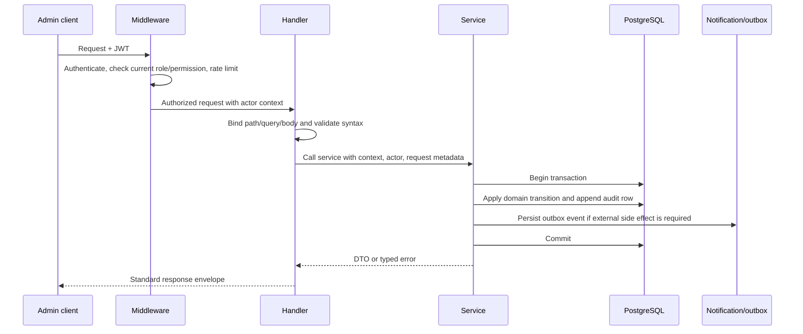
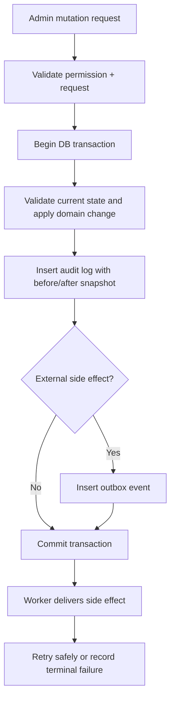

# PropVest Milestone 7 — Administration Module
## Production Architecture and Implementation Blueprint

**Status:** Design baseline for implementation; validate all repository-specific details before coding.  
**Stack from the design prompt:** Go, Gin, PostgreSQL, GORM, RabbitMQ, Redis, Cloudinary, Paystack, SMTP, SMS provider.  
**Architecture:** Repository → Service → Handler.  
**Scope:** Operational administration for users, properties, investments, financial records, notifications, audit trails, and system health.

> **Important implementation rule:** This document is a design, not evidence that the described tables, fields, endpoints, queues, or services already exist exactly as written. Start by inspecting the repository, migrations, interfaces, route registration, tests, and existing property-approval and notification implementations. Preserve existing behavior and adapt names/types to the actual codebase. Do not create duplicate abstractions or migrations for structures that already exist.

---

## 1. Executive Summary

Milestone 7 adds a secure administration surface to PropVest. It should give authorized operators a reliable view of platform activity and controlled workflows for user accounts, property approvals, investments, financial monitoring, notifications, and platform health. Every consequential action must be authenticated, authorized, validated, auditable, and safe under retries or concurrent requests.

The implementation should extend the existing Clean Architecture rather than introduce a parallel framework. HTTP handlers bind and validate requests, services enforce business rules and orchestrate transactions, repositories perform scoped database operations, and existing authentication, RBAC, response, logging, notification, wallet, property, investment, queue, and configuration components should be reused where their contracts fit.

### Recommended delivery order

1. **Repository discovery and safety baseline:** inventory current capabilities, migrations, roles, session invalidation, financial state machines, existing property approval, notifications, and test conventions.
2. **Audit foundation and authorization:** append-only audit records, actor/request metadata, role hierarchy, protected admin route group, and security tests.
3. **Read-only operational views:** dashboard, users, user details, properties, investments, transactions, payments, withdrawals, notification delivery status, and audit search.
4. **Low-risk workflows:** user suspension/activation, KYC decisions, property approval/rejection, session revocation, and notification retry where idempotent.
5. **Financially consequential workflows:** refunds, withdrawal approval/rejection, investment cancellation, and returns distribution only after the existing domain state machines and ledger invariants have been documented and tests exist. Do not implement direct balance edits or invented financial transitions.
6. **Reports, exports, observability, performance, documentation, and release verification.**

### Architectural decisions

- Use the existing authentication flow; do not create a separate admin login unless discovery proves a separate identity boundary is required. Enforce admin MFA/step-up authentication for high-risk actions if the platform supports it; otherwise document this as a release requirement rather than pretending it exists.
- Use synchronous, transactional audit writes for administrative state changes. If an action changes business data, its audit record must commit or roll back in the same database transaction. Use an outbox only when a separate asynchronous event is required; do not enqueue an audit write and risk losing the audit record.
- Keep user deletion soft by default, consistent with the existing `DeletedAt` field. Hard deletion must be a separate, reviewed privacy/retention process with dependency and legal checks.
- Use Redis caching only for read-heavy dashboard aggregates after correctness and query performance are measured. Start with short TTLs and explicit invalidation/versioning; PostgreSQL remains the source of truth.
- Make financial operations idempotent and ledger-backed. Every money movement must reuse established wallet/payment/withdrawal/investment services and transactions, with unique idempotency keys where supported. Admin endpoints must not directly update wallet balance columns.
- Use explicit permissions for sensitive operations, even if the initial public roles remain `admin` and `super_admin`. Never rely solely on a role claim that can remain stale after role changes; verify current actor status/permissions through a safe established mechanism or revoke sessions when privileges change.
- Treat health endpoints as operational metadata, not an unauthenticated route to secrets, connection strings, internal hostnames, provider credentials, or raw infrastructure errors.

### Out of scope unless confirmed during discovery

- Building a separate frontend/admin portal.
- Introducing Elasticsearch, a new message broker, or a new permissions product.
- Changing the financial domain model or provider integrations wholesale.
- Creating new financial operations whose business rules are not already defined.
- Promising email open rates unless the email provider sends reliable tracking events and privacy policy permits collection.

---

## 2. Repository Discovery and Assumptions

The design prompt states that Milestones 0–6 are complete and references migrations `000001`–`000022`, but this must be confirmed in the working repository. Discovery is the first implementation task.

### Inspect at minimum

- `cmd/api/main.go`, `cmd/worker/main.go`, route registration, middleware, configuration and dependency injection.
- User model and migrations: role, status, KYC fields, soft deletion, session/refresh-token behavior, login history if any.
- Property model/service: existing approval/rejection transitions and notifications.
- Investment service: purchase, cancellation, maturity, ROI and return-distribution invariants.
- Wallet, payment and withdrawal services: transaction states, locked balances, ledger entries, Paystack references, reconciliation, refund behavior, idempotency and webhook handling.
- Notification module: persisted notifications versus delivery attempts, retries, delivery events, queue names, templates and existing admin bulk messaging.
- Existing audit/outbox implementations and error/response/logging conventions.
- Migration numbering and whether `000022` is already used by a different schema change.
- Tests, CI, lint/format rules, and current route/API documentation.

### Design prompt facts versus decisions to validate

The prompt describes `users`, `wallets`, `wallet_transactions`, `payments`, `properties`, `investments`, `notifications`, `notification_preferences`, `outbox`, and related tables. It also describes role values `user`, `admin`, `super_admin`, and status values `active`, `suspended`, `deleted`. These are the baseline assumptions for this plan, not a guarantee that actual schema names or enum values match exactly.

Before adding a migration, compare the actual schema and migration history. Use the next unused migration number rather than assuming a particular number.

---

## 3. Architecture Overview

### 3.1 Component diagram



### 3.2 Request flow



### 3.3 Transactional audit pattern

For an admin mutation, the business change and audit entry should be committed in one transaction. If notification or email delivery is required, write an outbox event in the same transaction and let a worker deliver it. Never make SMTP/SMS/HTTP provider calls while holding a database transaction open.



### 3.4 Suggested package boundaries

Use existing package conventions; these are logical responsibilities, not a requirement to create every file if equivalent components already exist.

- `internal/models/audit_log.go`
- `internal/repositories/audit_log_repository.go`
- `internal/services/audit_service.go`
- `internal/services/admin_service.go`
- `internal/services/dashboard_service.go`
- `internal/handlers/admin_handler.go` or focused handlers by domain
- `internal/dto/admin_dto.go`, with domain-specific DTOs if that matches current conventions
- `internal/routes/admin_routes.go` or the existing route group file
- `internal/middleware` only if the current RBAC middleware needs a backward-compatible extension
- migration files for audit logs and carefully selected user/property metadata fields

Do not build a second copy of the user, property, investment, wallet, payment, withdrawal, or notification business logic inside `AdminService`. Admin services should orchestrate existing domain services and add admin-specific authorization, reporting, and audit behavior.

---

## 4. Authorization and Security Model

### 4.1 Role/permission matrix

Start with existing `user`, `admin`, and `super_admin` roles. Add fine-grained permissions internally only if the codebase can enforce and test them consistently. Do not introduce new role names without a product/security decision.

| Capability | User | Admin | Super admin |
|---|---:|---:|---:|
| Access admin API | No | Yes | Yes |
| View operational dashboard | No | Yes | Yes |
| View users and non-secret profile details | No | Yes | Yes |
| Suspend/activate ordinary user | No | Yes | Yes |
| Approve/reject KYC | No | Yes, if assigned | Yes |
| Approve/reject property | No | Yes, if assigned | Yes |
| View financial records | No | Yes, least privilege | Yes |
| Execute refund/withdrawal/investment money action | No | Explicit permission + step-up | Explicit permission + step-up |
| Change user role to admin | No | No | Yes, with audit and session revocation |
| Modify/delete super-admin account | No | No | Restricted; require separate safeguard/second approver |
| Read/export audit logs | No | Yes, least privilege | Yes |
| Change platform-wide settings | No | No or explicit permission | Yes, audited |
| View detailed system health | No | Limited | Yes/operations permission |

A simple role check is a baseline. High-risk actions should additionally enforce actor/target hierarchy, recent authentication or MFA when available, reason text, idempotency key, and optionally dual control.

### 4.2 Mandatory rules

1. Every `/api/v1/admin/**` route must require authentication and explicit admin authorization.
2. Do not trust client-provided `actor_id`, role, or target ownership. Derive actor identity from authenticated context.
3. Never return password hashes, refresh-token secrets, OTPs, verification tokens, provider secrets, or unrestricted internal error text.
4. Redact sensitive fields from logs and audit snapshots. Use an allowlist of safe fields rather than serializing whole GORM models.
5. Ensure every mutation checks target existence and current state inside the service/transaction, not only in the handler.
6. Prevent admins from elevating their own privileges or modifying super-admin accounts unless an explicitly approved rule permits it.
7. Session invalidation must be real: revoke refresh tokens and ensure access-token invalidation behavior is understood. If access JWTs are stateless until expiry, document the limitation and implement a revocation/version mechanism if required by the existing auth architecture.
8. Use stricter rate limits for role changes, password resets, exports, bulk actions, refunds, withdrawal decisions and return distributions.
9. Add reason fields for suspensions, KYC rejection, property rejection, refunds, cancellations and manual corrections where applicable.
10. All list endpoints must be paginated and bounded. Exports must be bounded or asynchronous, permissioned, and audited.
11. Treat IP address and user-agent as untrusted metadata; normalize and length-limit them.
12. Do not put sensitive personal data into Redis keys, queue messages, metrics labels, or logs.

### 4.3 Step-up and dual-control recommendations

For high-risk financial or privileged-account actions, require a recent-authentication/MFA challenge if supported by the platform. For refunds, manual financial corrections, large withdrawals, return distributions and changes to super-admin access, consider a two-person approval workflow with configurable thresholds. If the current product has no such workflow, phase the action behind a feature flag or leave execution disabled rather than shipping a weak approximation.

---

## 5. Database Design and Migrations

### 5.1 Migration policy

Use the next unused migration sequence after inspecting the repository. Split migrations into reversible, focused units, for example:

- `NNNNNN_create_audit_logs.up.sql` / `.down.sql`
- `NNNNNN_add_admin_user_metadata.up.sql` / `.down.sql`
- `NNNNNN_add_property_approval_metadata.up.sql` / `.down.sql`
- Optional `NNNNNN_create_admin_settings.up.sql` / `.down.sql` only if settings are required in this milestone.

Do not blindly assume `000023`; the source prompt says migration files currently run through `000022`, which must be verified.

### 5.2 Audit log table

Use an append-only table. `target_id` is not a foreign key because a generic audit target may refer to several domain tables. `actor_id` can become null if the user record is removed, while the immutable actor snapshot retains enough non-sensitive context to interpret the event. Keep snapshots allowlisted and redacted.

```sql
CREATE TABLE audit_logs (
    id UUID PRIMARY KEY DEFAULT gen_random_uuid(),
    actor_id UUID NULL REFERENCES users(id) ON DELETE SET NULL,
    actor_type VARCHAR(32) NOT NULL CHECK (actor_type IN ('admin', 'user', 'system')),
    actor_role VARCHAR(32),
    action VARCHAR(100) NOT NULL,
    description TEXT,
    target_type VARCHAR(50) NOT NULL,
    target_id UUID,
    old_values JSONB,
    new_values JSONB,
    reason TEXT,
    ip_address VARCHAR(45),
    user_agent TEXT,
    request_id VARCHAR(100),
    idempotency_key VARCHAR(128),
    created_at TIMESTAMPTZ NOT NULL DEFAULT NOW()
);

CREATE INDEX idx_audit_logs_created_at_id
    ON audit_logs (created_at DESC, id DESC);
CREATE INDEX idx_audit_logs_actor_created
    ON audit_logs (actor_id, created_at DESC);
CREATE INDEX idx_audit_logs_action_created
    ON audit_logs (action, created_at DESC);
CREATE INDEX idx_audit_logs_target_created
    ON audit_logs (target_type, target_id, created_at DESC);
CREATE INDEX idx_audit_logs_actor_type_created
    ON audit_logs (actor_type, created_at DESC);
CREATE UNIQUE INDEX uq_audit_logs_actor_idempotency
    ON audit_logs (actor_id, idempotency_key)
    WHERE idempotency_key IS NOT NULL;
```

If the project does not support `gen_random_uuid()` in the configured PostgreSQL environment, use the UUID default convention already established by its migrations. Verify extension requirements rather than adding an extension without review.

**Append-only enforcement:** application repository should expose create/query only; do not expose update/delete methods. Consider a database role/trigger that denies update/delete in production if operationally compatible. Retention must not silently delete compliance-required records; define retention with legal/product/security owners. If deletion is legally required, use a documented archival/purge procedure with its own audit trail.

**Partitioning:** do not start with partitioning unless volume and query measurements justify it. Design indexes and queries so time-based partitioning can be added later. For millions of records, evaluate monthly range partitioning on `created_at`, but test foreign-key, unique-key, migration and operational implications first.

### 5.3 Optional admin settings table

Only add this if there is a concrete settings requirement. Avoid using generic JSON settings for security-critical configuration that needs typed validation or deployment-level secret management.

```sql
CREATE TABLE admin_settings (
    id UUID PRIMARY KEY DEFAULT gen_random_uuid(),
    key VARCHAR(100) NOT NULL UNIQUE,
    value JSONB NOT NULL,
    description TEXT,
    updated_by UUID NULL REFERENCES users(id) ON DELETE SET NULL,
    created_at TIMESTAMPTZ NOT NULL DEFAULT NOW(),
    updated_at TIMESTAMPTZ NOT NULL DEFAULT NOW()
);
CREATE INDEX idx_admin_settings_updated_at ON admin_settings(updated_at DESC);
```

Do not store credentials, API secrets, or signing keys in this table. Prefer environment/secret-manager configuration.

### 5.4 User metadata additions

First check whether these fields already exist and whether equivalent history tables are present. `admin_notes` can contain sensitive information, so it should be access-controlled and its use documented. A single text field does not provide author/time history; prefer a separate notes table if multiple admins need attributable notes.

Minimal schema option:

```sql
ALTER TABLE users
    ADD COLUMN IF NOT EXISTS suspended_at TIMESTAMPTZ NULL,
    ADD COLUMN IF NOT EXISTS suspended_by UUID NULL REFERENCES users(id) ON DELETE SET NULL,
    ADD COLUMN IF NOT EXISTS suspended_reason TEXT NULL;
```

Recommended notes table when note history is required:

```sql
CREATE TABLE admin_user_notes (
    id UUID PRIMARY KEY DEFAULT gen_random_uuid(),
    user_id UUID NOT NULL REFERENCES users(id) ON DELETE CASCADE,
    author_id UUID NULL REFERENCES users(id) ON DELETE SET NULL,
    note TEXT NOT NULL,
    created_at TIMESTAMPTZ NOT NULL DEFAULT NOW()
);
CREATE INDEX idx_admin_user_notes_user_created
    ON admin_user_notes(user_id, created_at DESC);
```

Avoid adding `admin_notes TEXT` directly to `users` if the audit/history table is chosen. Notes must never be sent to the end user or general notification templates.

### 5.5 Property approval metadata

Confirm whether an approval workflow and its columns already exist. Add only missing fields. If one reviewer is enough:

```sql
ALTER TABLE properties
    ADD COLUMN IF NOT EXISTS approved_by UUID NULL REFERENCES users(id) ON DELETE SET NULL,
    ADD COLUMN IF NOT EXISTS approved_at TIMESTAMPTZ NULL,
    ADD COLUMN IF NOT EXISTS rejection_reason TEXT NULL;
```

If the existing workflow supports “request changes”, prefer explicit state and review history rather than overloading `draft` or a free-text reason. Keep valid transitions in the property service and use optimistic state checks or row locks to avoid concurrent approval/rejection races.

### 5.6 No unnecessary schema duplication

- Dashboard values should normally be computed from existing tables/views, not duplicated into mutable counters.
- Do not create a separate admin copy of users, properties, investments or transactions.
- Do not add notification delivery columns to `notifications` without checking whether delivery attempts/events are already modeled separately.
- Do not add a login-history table unless there is an actual source of login events to populate it. If absent, show that login history is unavailable rather than fabricate it.
- Use the actual financial ledger and payment/withdrawal tables; never derive financial totals from wallet balance alone.

---

## 6. API Conventions

### 6.1 Common rules

- Base path: `/api/v1/admin`.
- Authenticated admin routes; high-risk endpoints require stronger permission/step-up policy.
- Use the existing response envelope and error mapper.
- UUID path parameters must be parsed and validated before service calls.
- Pagination: `page` defaults to 1, `page_size` defaults to 20, maximum 100. Validate integer bounds.
- Use UTC RFC3339 timestamps in API responses.
- Date filters should use explicit inclusive/exclusive semantics; recommended `from` inclusive and `to` exclusive.
- Sort fields must be allowlisted; never interpolate arbitrary query parameters into SQL order clauses.
- Use stable ordering such as `(created_at DESC, id DESC)` for paginated results.
- For money, return integer minor units plus currency and optionally a display amount. Never use floating point for money.
- Mutation endpoints should accept an idempotency key for financial/high-risk actions and return the original outcome for safe retries.
- Error responses should not expose SQL errors or provider secrets.

### 6.2 Suggested standard response shape

Adapt to the actual `internal/response` implementation; do not create a competing envelope if one already exists.

```json
{
  "success": true,
  "data": {},
  "meta": {
    "page": 1,
    "page_size": 20,
    "total": 0,
    "total_pages": 0
  }
}
```

### 6.3 Common errors

| Condition | HTTP | Error code concept |
|---|---:|---|
| Missing/invalid authentication | 401 | `unauthorized` |
| Authenticated but lacks permission | 403 | `forbidden` |
| Target does not exist | 404 | `not_found` |
| Invalid UUID/query/body/state transition | 400 or 422 per existing convention | `validation_failed` |
| State conflict / duplicate idempotency conflict | 409 | `conflict` |
| Rate limit exceeded | 429 | `rate_limited` |
| Temporary internal dependency failure | 503 where appropriate | `service_unavailable` |
| Unexpected error | 500 | `internal_error` |

Use existing custom errors and HTTP mappings rather than introducing duplicate error types.

---

## 7. API Specification

The endpoints below are the target surface from the design prompt, refined with safe request contracts. Exact DTO names and response envelopes should match existing code conventions. If a feature is unsupported by the actual schema, document it and defer it instead of returning fabricated data.

### 7.1 Dashboard

#### `GET /api/v1/admin/dashboard`

Query: optional `from`, `to`, and `refresh` only if refresh bypass is permissioned and rate-limited. Default period should be explicitly documented.

Response data:

```json
{
  "users": {
    "total": 0,
    "active_last_30_days": 0,
    "new_this_month": 0,
    "new_last_month": 0,
    "by_kyc_status": {"pending": 0, "approved": 0, "rejected": 0},
    "by_status": {"active": 0, "suspended": 0}
  },
  "financial": {
    "wallet_liability_minor": 0,
    "currency": "NGN",
    "deposits_minor_all_time": 0,
    "withdrawals_minor_all_time": 0,
    "investments_minor_all_time": 0,
    "pending_withdrawals_count": 0,
    "pending_withdrawals_minor": 0
  },
  "properties": {
    "total": 0,
    "by_status": {},
    "available_slots": 0,
    "funding_completion_percent": null
  },
  "investments": {
    "active_count": 0,
    "active_value_minor": 0,
    "average_investment_minor": 0,
    "monthly_series": []
  },
  "recent_activity": {
    "registrations": [],
    "investments": [],
    "transactions": [],
    "notifications": []
  },
  "generated_at": "2026-01-01T00:00:00Z",
  "data_as_of": "2026-01-01T00:00:00Z"
}
```

Notes:
- `wallet_liability_minor` should be clearly defined as the sum of spendable/held wallet balances according to the actual wallet model; do not label it “platform value” if that could be mistaken for revenue or company assets.
- Define deposit/withdrawal totals from finalized ledger/payment states only; avoid counting initiated or failed attempts as completed volume.
- A funding completion percentage needs a clear formula. Recommended property-weighted aggregate: funded slot count / total slots across eligible published/funded properties × 100; confirm product semantics. Return `null` when denominator is zero.
- `active users` must use a real activity source such as `last_login_at` if maintained; otherwise state the metric is unavailable or define an alternative based on actual events.
- Recent notifications are meaningful only if delivery state/attempts are modeled. Do not equate a created in-app notification with an email delivered.

### 7.2 User management

#### `GET /api/v1/admin/users`

Query: `page`, `page_size`, `search`, `status`, `role`, `kyc_status`, `created_from`, `created_to`, `sort_by`, `sort_order`.

Allowed `sort_by`: `created_at`, `last_login_at`, `name`, and `total_invested` only if implemented through a safe aggregate/join. Allowed `sort_order`: `asc`, `desc`.

Response: paginated safe user summary, never including password/token fields. Include `id`, name, email, phone (mask according to permission), role, KYC status, status, email/phone verification flags, `created_at`, `last_login_at` if available, and `total_invested_minor` only when computed correctly.

#### `GET /api/v1/admin/users/:id`

Return a user detail DTO plus separately scoped related summaries: wallet balances, portfolio/investments, recent transactions, login history if actually stored, notifications, KYC documents/metadata. Use independent pagination for long collections rather than returning unbounded arrays. KYC document URLs should be permissioned and short-lived if the storage layer supports signed access. Do not return password hashes, refresh tokens, OTPs, or verification tokens.

#### `PATCH /api/v1/admin/users/:id`

Request example:

```json
{
  "first_name": "Updated",
  "last_name": "Name",
  "phone_number": "+234...",
  "reason": "Verified correction from support ticket"
}
```

Only allowlisted fields. Email changes must reuse existing email verification and uniqueness rules; do not silently mark a new email verified. Role changes should use a dedicated endpoint to apply hierarchy checks, audit, and session revocation.

#### `PATCH /api/v1/admin/users/:id/suspend`

```json
{"reason":"Policy violation","idempotency_key":"client-generated-unique-value"}
```

Must atomically transition status, record suspension metadata, revoke refresh sessions, write audit log and outbox event for notification if needed. Make repeated suspension idempotent or return a documented 409. Define what happens to pending financial operations; do not automatically confiscate or move funds.

#### `PATCH /api/v1/admin/users/:id/activate`

```json
{"reason":"Suspension review completed","idempotency_key":"client-generated-unique-value"}
```

Must not re-enable a deleted user or bypass required verification. Audit and notify via outbox.

#### `POST /api/v1/admin/users/:id/reset-password`

Request: `{"reason":"Account recovery request"}`. Prefer triggering the existing password-reset flow; never set or return a known password. Rate-limit and audit. Do not reveal whether an email/phone is deliverable.

#### `POST /api/v1/admin/users/:id/logout-all`

Request: `{"reason":"Security incident"}`. Revoke all refresh tokens and apply the existing access-token invalidation mechanism. If JWT access tokens cannot be revoked immediately, explicitly document expiry-window behavior and close the gap where needed.

#### `PATCH /api/v1/admin/users/:id/role`

Request: `{"role":"admin","reason":"Approved staff access request"}`. Super-admin only by default. Prevent self-elevation and regular-admin changes to admin/super-admin accounts. Revoke sessions so new permissions take effect. Require audit and preferably second-person approval for privileged role changes.

#### `PATCH /api/v1/admin/users/:id/kyc`

Request: `{"decision":"approved","reason":"Documents verified"}` or `{"decision":"rejected","reason":"Document mismatch"}`. Use existing KYC state model and validation; do not invent a KYC provider or approve without required evidence. Store reviewer and timestamp if the existing model lacks equivalent fields.

#### `DELETE /api/v1/admin/users/:id`

Prefer soft delete, require reason, recent authentication/step-up, and safety checks. Do not hard-delete ledger, investments, audit history, or legal records. Consider blocking deletion if there are unresolved balances, pending withdrawals, active investments, or retention obligations. Return a conflict with safe explanation and require a separate reviewed workflow for exceptional cases.

#### Related read endpoints

- `GET /api/v1/admin/users/:id/investments?page=1&page_size=20`
- `GET /api/v1/admin/users/:id/transactions?page=1&page_size=20`
- `GET /api/v1/admin/users/:id/audit-log?page=1&page_size=20`

Each must scope by the supplied user/target and paginate. User audit history should not expose unrelated actors' private information beyond necessary audit metadata.

### 7.3 Property management

#### `GET /api/v1/admin/properties`

Query: pagination, `status`, `created_by`, `search`, `created_from`, `created_to`, `min_funding_percent`, `max_funding_percent`, `sort_by`, `sort_order`. Allowlist sort keys; compute funding level from actual slots/investment relations.

#### `GET /api/v1/admin/properties/:id/analytics`

Return property summary, total/available/sold slots, investor count, invested amount, funding percentage, and relevant lifecycle timestamps. Define “revenue generated” carefully; investment principal is not platform revenue. Use one aggregate query or a small number of bounded queries, not N+1 loops.

#### `PATCH /api/v1/admin/properties/:id/approve`

Request: `{"reason":"Due diligence completed","idempotency_key":"..."}`. Validate required documents, current state, and approval eligibility through the existing property service. Store reviewer/timestamp; audit and notify through outbox. Repeated approval must be safely idempotent or a documented conflict.

#### `PATCH /api/v1/admin/properties/:id/reject`

Request: `{"reason":"Required ownership documents are missing"}`. Require a meaningful reason; validate allowed source states and do not overwrite already-funded/closed property state.

#### `PATCH /api/v1/admin/properties/:id/request-changes`

Optional if supported by product: `{"reason":"Upload a clearer title document"}`. Prefer an explicit `changes_requested` state if the domain supports it; do not overload unrelated statuses.

#### `GET /api/v1/admin/properties/:id/investors`

Paginated investor list with only fields necessary for operations. Mask PII unless full access is justified by permission.

Bulk property operations should be added only after single-record transitions are correct. Use a bounded batch size, per-item results, all-or-nothing only when business rules genuinely support it, and an audit entry for each target or one parent event with child references. Avoid a bulk endpoint that silently partially succeeds.

### 7.4 Investment management

#### `GET /api/v1/admin/investments`

Query: `page`, `page_size`, `status`, `property_id`, `user_id`, `created_from`, `created_to`, `search`, `sort_by`, `sort_order`.

#### `GET /api/v1/admin/investments/:id`

Return investment details, user/property references, relevant ledger transactions and lifecycle events. Use safe DTOs.

#### `GET /api/v1/admin/investments/metrics`

Return counts/value by state, investment volume trend, average/median if supported efficiently, and actual return-distribution totals. Clearly distinguish principal, current value, realized return, expected ROI, and platform revenue.

#### `PATCH /api/v1/admin/investments/:id/cancel`

Request: `{"reason":"Approved exception","idempotency_key":"..."}`. **Do not implement cancellation as a direct status update.** Reuse the investment service's cancellation/refund flow, verify eligibility, atomically create required ledger entries, release/adjust slots according to domain rules, and audit. If the existing system has no well-defined cancellation/refund state machine, deliver read-only investment management first and defer this endpoint until the domain is designed and reviewed.

#### `POST /api/v1/admin/investments/:id/distribute-returns`

Only implement if the return-distribution business rules already exist. Request should include an idempotency key and an explicit distribution batch/reference; never let the client choose arbitrary credited amounts without server-side calculation/validation. For bulk distribution, prefer a durable distribution record, transactionally created ledger entries or a well-defined batch processor, reconciliation and per-beneficiary idempotency. Consider dual control and thresholds. If no existing return calculation is authoritative, do not ship this endpoint in the first release.

#### Mark as matured

Prefer a domain scheduler/state-transition service that computes maturity from the investment's dates and product rules. Admins may trigger/retry an eligible transition, but must not set maturity arbitrarily. Audit manual intervention.

### 7.5 Financial management

#### `GET /api/v1/admin/transactions`

Query: pagination, `type`, `status`, `user_id`, `from`, `to`, `min_amount_minor`, `max_amount_minor`, `reference`, `sort_by`, `sort_order`. Use integer minor units and currency. Search must be indexed/bounded and avoid unescaped SQL fragments.

#### `GET /api/v1/admin/payments`

Paginated payment attempts with provider reference, status, amount/currency, user reference, created/updated times, and safe failure category. Never return secrets or raw provider payloads without redaction.

#### `GET /api/v1/admin/withdrawals`

Paginated withdrawals with filters, status, age, user, amount and provider reference. Define pending state using the actual withdrawal model/state machine.

#### `PATCH /api/v1/admin/withdrawals/:id/approve`

Only add if withdrawals genuinely have an admin-review stage in the existing domain. Request: `{"reason":"Reviewed","idempotency_key":"..."}`. Reuse withdrawal service/provider integration; do not bypass locked-balance, transfer state, reconciliation or webhook logic. If transfer initiation is already automatic after request, an “approve” endpoint may be conceptually wrong and must be omitted or redesigned.

#### `PATCH /api/v1/admin/withdrawals/:id/reject`

Request: `{"reason":"Account verification failed","idempotency_key":"..."}`. Reuse domain logic to release locked funds exactly once. Reject only an eligible state. A failed transfer and an admin rejection are distinct outcomes and must not be conflated.

#### Refunds

The source prompt mentions retrying failed payments and refund processing but does not define a refund endpoint. Add only after inspecting the existing payment provider API and financial domain. A refund must have a durable refund record, provider idempotency/reference, authorization, reason, amount bounds, ledger consistency, retry/reconciliation, and audit. Never retry a provider call blindly when its outcome is unknown; reconcile by provider reference first.

#### `GET /api/v1/admin/financial-reports`

Query: `from`, `to`, `group_by` (day/week/month), and optional report type. Return totals, counts, success/failure rates and series with explicit definitions and currency. Bound date ranges and use asynchronous exports for large result sets.

### 7.6 Audit log APIs

#### `GET /api/v1/admin/audit-logs`

Query: pagination, `actor_id`, `actor_type`, `action`, `target_type`, `target_id`, `from`, `to`, `request_id`. Use stable sort and index-supported filters.

#### `GET /api/v1/admin/audit-logs/:id`

Return one event with safe, redacted before/after values. Require audit-read permission.

#### `GET /api/v1/admin/audit-logs/export`

Export CSV for a bounded date range, with a strict row cap or asynchronous export job. Audit the export itself. CSV fields must be escaped against formula injection (`=`, `+`, `-`, `@` prefixes) and redact restricted fields. Consider expiring signed download URLs.

#### `POST /api/v1/admin/audit-logs/report`

Request: `{"from":"...","to":"...","report_type":"admin_activity"}`. Validate bounded ranges and supported report types. If report generation is expensive, enqueue a job and return `202 Accepted` with a job ID/status endpoint rather than blocking a request.

Audit logs are append-only. Do not expose update/delete routes.

### 7.7 Notification administration

#### `GET /api/v1/admin/notifications/sent`

Query: pagination, `type`, `user_id`, `delivery_status`, `channel`, `from`, `to`. This endpoint requires a real delivery-attempt/event source. If Milestone 6 only stores in-app notifications and has no per-channel delivery record, first add or identify a reliable delivery-events model instead of inferring delivery from the notification row.

#### `GET /api/v1/admin/notifications/analytics`

Return volume and success/failure/retry/DLQ rates by channel/type and period. Define denominators; exclude queued/in-progress from terminal delivery success rates. Email open rates are optional and should only be exposed if provider tracking is available and privacy-reviewed.

#### `POST /api/v1/admin/notifications/:id/resend`

Request: `{"channel":"email","reason":"User requested resend","idempotency_key":"..."}`. Reuse the existing notification service and queue. Verify recipient, consent/preferences and delivery eligibility. Prevent resend storms; distinguish retrying a failed attempt from intentionally creating a new notification. Audit all resends.

### 7.8 System health and monitoring

#### `GET /api/v1/admin/health/system`

Return high-level statuses for database, RabbitMQ, Redis, Paystack reachability/configuration, Cloudinary and SMS provider, including `status`, `checked_at`, and a sanitized error category. Use timeouts and circuit-breaker-friendly probes. Do not expose credentials, DSNs, internal network topology, or raw provider responses.

#### `GET /api/v1/admin/health/queues`

RabbitMQ queue depth and consumer status require a supported management API/adapter or metrics endpoint. Do not claim to know queue depth from a basic AMQP connection. Return `unsupported`/`unknown` if the infrastructure does not expose this data. Protect the endpoint with an operations-level permission.

#### `GET /api/v1/admin/health/metrics`

Prefer existing Prometheus/OpenTelemetry/metrics infrastructure. Expose aggregated counters, latency percentiles and error rates, not per-user sensitive labels. If no metrics collector exists, make this endpoint a thin integration or defer it rather than storing inaccurate timings ad hoc.

---

## 8. Go Service and Repository Interfaces

These are interface sketches. Align signatures with current repository interfaces, custom errors, logger and transaction abstractions. Avoid an interface explosion; split by responsibility when a single interface becomes difficult to mock.

```go
package services

type AdminService interface {
    ListUsers(ctx context.Context, actor Actor, filter UserAdminFilter) (*dto.AdminUserListResponse, error)
    GetUser(ctx context.Context, actor Actor, userID uuid.UUID) (*dto.AdminUserDetailResponse, error)
    UpdateUser(ctx context.Context, actor Actor, userID uuid.UUID, req dto.AdminUpdateUserRequest, meta RequestMeta) error
    SuspendUser(ctx context.Context, actor Actor, userID uuid.UUID, req dto.AdminUserActionRequest, meta RequestMeta) error
    ActivateUser(ctx context.Context, actor Actor, userID uuid.UUID, req dto.AdminUserActionRequest, meta RequestMeta) error
    ForcePasswordReset(ctx context.Context, actor Actor, userID uuid.UUID, req dto.AdminUserActionRequest, meta RequestMeta) error
    LogoutAllSessions(ctx context.Context, actor Actor, userID uuid.UUID, req dto.AdminUserActionRequest, meta RequestMeta) error
    ChangeUserRole(ctx context.Context, actor Actor, userID uuid.UUID, req dto.AdminChangeRoleRequest, meta RequestMeta) error
    DecideKYC(ctx context.Context, actor Actor, userID uuid.UUID, req dto.AdminKYCDecisionRequest, meta RequestMeta) error
    SoftDeleteUser(ctx context.Context, actor Actor, userID uuid.UUID, req dto.AdminUserActionRequest, meta RequestMeta) error
}

type DashboardService interface {
    GetDashboard(ctx context.Context, actor Actor, filter DashboardFilter) (*dto.AdminDashboardResponse, error)
    GetInvestmentMetrics(ctx context.Context, actor Actor, filter MetricsFilter) (*dto.AdminInvestmentMetricsResponse, error)
    GetFinancialReport(ctx context.Context, actor Actor, filter FinancialReportFilter) (*dto.AdminFinancialReportResponse, error)
}

type AuditService interface {
    Record(ctx context.Context, tx *gorm.DB, event AuditEvent) error
    List(ctx context.Context, actor Actor, filter AuditLogFilter) (*dto.AuditLogListResponse, error)
    Get(ctx context.Context, actor Actor, auditID uuid.UUID) (*dto.AuditLogResponse, error)
    RequestExport(ctx context.Context, actor Actor, filter AuditExportRequest, meta RequestMeta) (*dto.ExportJobResponse, error)
}

type Actor struct {
    ID   uuid.UUID
    Role string
}

type RequestMeta struct {
    RequestID string
    IPAddress string
    UserAgent string
}

type AuditEvent struct {
    ActorID        *uuid.UUID
    ActorType      string
    ActorRole      string
    Action         string
    Description    string
    TargetType     string
    TargetID       *uuid.UUID
    OldValues      map[string]any
    NewValues      map[string]any
    Reason         string
    RequestMeta    RequestMeta
    IdempotencyKey string
}
```

`*gorm.DB` in a service-facing interface can couple the service to GORM. Prefer the project's existing transaction abstraction if it has one. The example makes atomicity visible; adapt to the established pattern.

### Repository responsibilities

```go
type AuditLogRepository interface {
    Create(ctx context.Context, tx Transaction, log *models.AuditLog) error
    FindByID(ctx context.Context, id uuid.UUID) (*models.AuditLog, error)
    List(ctx context.Context, filter repositories.AuditLogFilter, page, pageSize int) ([]models.AuditLog, int64, error)
}

type AdminReadRepository interface {
    ListUsers(ctx context.Context, filter repositories.AdminUserFilter, page, pageSize int) ([]repositories.AdminUserRow, int64, error)
    GetUserDetail(ctx context.Context, userID uuid.UUID) (*repositories.AdminUserDetailRow, error)
    GetDashboardMetrics(ctx context.Context, filter repositories.DashboardFilter) (*repositories.DashboardMetrics, error)
    ListAdminTransactions(ctx context.Context, filter repositories.TransactionFilter, page, pageSize int) ([]repositories.TransactionRow, int64, error)
}
```

These are conceptual contracts; do not duplicate existing `UserRepository`, `PropertyRepository`, etc. Extend an existing repository when that is the local convention. Use dedicated read-query methods for dashboard aggregates rather than loading all records into Go memory.

### DTO guidance

- Define explicit admin DTOs, not direct serialization of GORM models.
- Use `int64` for money in minor units, paired with currency.
- Use `*time.Time` for nullable timestamps.
- Do not expose secrets or unbounded nested records.
- Keep request DTOs allowlisted and validation-tagged according to existing conventions.

---

## 9. Dashboard Metrics, Queries, and Caching

### 9.1 Define metric semantics before implementation

| Metric | Recommended source/definition | Caution |
|---|---|---|
| Total users | Count non-deleted users according to product definition | Clarify whether suspended users count |
| Active users, last 30 days | Distinct users with real activity event or `last_login_at` in window | Registration alone is not activity |
| New users this/last month | `created_at` grouped by UTC calendar month | Document timezone |
| KYC counts | Group by actual KYC states | Include unknown states separately rather than dropping them |
| Wallet liability | Sum applicable main, earnings and locked balances based on actual schema | Not company revenue/assets |
| Deposits | Sum successful/finalized deposit ledger/payment records | Avoid double-counting payment and ledger rows |
| Withdrawals | Sum completed withdrawals/ledger debits | Separate initiated, failed and reversed amounts |
| Investments | Sum investment principal once per investment or ledger source of truth | Avoid double-counting transaction and investment rows |
| Pending withdrawals | Count/sum records in actual pending/review/processing states | State names must come from the domain model |
| Available slots | Sum `available_slots` for eligible properties | Exclude deleted/unavailable properties as product defines |
| Funding percentage | Explicit slot- or amount-weighted formula | Do not average per-property percentages without a decision |
| Investment growth trend | Monthly finalized investment volume/count | Define gross volume vs net after cancellations |

### 9.2 Query strategy

- Use aggregate SQL/ORM expressions and bounded joins; never fetch all users/transactions then aggregate in memory.
- Avoid N+1 queries in recent activity and user details.
- Add indexes only after examining query plans and existing indexes. Potential indexes include `(created_at)`, `(status, created_at)`, `(user_id, created_at)`, and `(property_id, status)` on the actual tables where filters justify them.
- Use `EXPLAIN (ANALYZE, BUFFERS)` against representative staging data for expensive aggregates.
- Ensure financial queries use the same canonical statuses/ledger semantics as operational services.

### 9.3 Redis recommendation

**Recommendation: introduce caching only after a correct uncached query exists and its latency is measured.** Begin with a 30–60 second TTL for dashboard aggregates, adjusted to freshness requirements. Do not cache detailed user data, raw financial records, audit logs or authorization decisions by default.

Cache key example: `admin:dashboard:v1:{period}:{scope}`. Avoid PII in keys. Include a schema/version prefix. Cache invalidation options:

1. Short TTL as the correctness baseline.
2. Best-effort invalidation after successful mutations affecting a metric.
3. Optional version counter for broad invalidation if the existing Redis wrapper supports atomic increments.
4. On Redis failure, fall back to the database with timeouts and sensible load protection; never fail a security-sensitive mutation because cache invalidation failed after the database commit.

If metrics need near-real-time accuracy, use event-driven invalidation via the existing outbox only after reliable event coverage is established. State `data_as_of` in the API. Avoid materialized views until query plans and refresh costs demonstrate a need.

---

## 10. Audit Logging Strategy

### 10.1 Actions to record

At minimum, record the actions listed in the design prompt:

- User: account updated, suspended, activated, deleted, role changed, password reset initiated, sessions revoked, KYC approved/rejected.
- Property: approved, rejected, changes requested, status changed.
- Investment: cancellation attempt/outcome, maturity intervention, return distribution batch.
- Wallet/finance: refund requested/processed/rejected, withdrawal approved/rejected, large-withdrawal intervention, any approved manual adjustment.
- Notification: bulk message sent, failed notification resent, export requested/completed.
- Admin/system: audit export, report generated, settings changed, privileged access changes.

Also record failed high-risk attempts when useful for security monitoring, but avoid flooding the audit table with every ordinary read. Consider a separate security event/operational log for authentication failures and rate-limit events.

### 10.2 Audit event requirements

Every record should include actor, role at time of action, action name, target, timestamp, request/correlation ID, IP/user agent when available, reason for consequential actions, and redacted old/new values. `old_values` and `new_values` should be allowlisted snapshots, not entire model JSON. For money operations include identifiers, currency, amount in minor units, state before/after and provider reference as safe metadata; never include secrets or full payment payloads.

### 10.3 Synchronous versus asynchronous

- **Synchronous in the same transaction:** audit record for admin mutations and business-state changes.
- **Outbox/async:** email/SMS, user notification, webhook-like external delivery, report generation and large exports.
- **Optional asynchronous analytics copy:** only if the primary audit row has already committed and the copy is not the compliance record.

### 10.4 Retention and privacy

The prompt raises a two-year retention option but does not establish a legal policy. Do not automatically delete audit logs after two years without product, legal and security approval. Define retention classes for financial, security, support and operational records; restrict access; support legal holds where applicable; and document archival/purge processes. Audit export access itself.

---

## 11. System Health and Observability

### Metrics to track

- HTTP request count, latency percentiles, error rates and rate-limit counts by route template/method/status class.
- Database connection pool utilization, query latency, transaction failures and slow queries.
- RabbitMQ publish failures, queue depth, consumer count/health, retries and dead-letter count if observable.
- Notification deliveries by channel and outcome.
- Paystack operation success/failure/unknown outcomes and reconciliation backlog.
- Withdrawal age by state, stuck transfers, locked balance reconciliation discrepancies.
- Outbox backlog/oldest pending age.
- Dashboard query latency/cache hit rate.
- Admin high-risk action counts and denied privilege-escalation attempts.

### Alert examples

Thresholds should be tuned using staging/production baselines, not invented as universal constants. Define alerts for sustained API error-rate spikes, database unavailability, queue backlog age/depth, repeated worker crashes, payment/withdrawal reconciliation backlog, outbox age, abnormal failed login/admin-action rates, and elevated refund/role-change volume.

### Health-check behavior

- Separate liveness from readiness. Liveness should not fail merely because a downstream provider is briefly unavailable; readiness may report required dependency status.
- Use strict timeouts and sanitize details.
- Avoid synchronous external-provider checks on every dashboard request; use cached/background health probes where possible.
- Do not expose queue management or process metrics to regular users.

---

## 12. Implementation Phases and Estimates

These are planning estimates, not guarantees. The source prompt estimates 20–30 hours for the whole module, but its requested scope is large. A production-ready implementation with financial workflows, exports, audit hardening and test coverage may exceed that estimate. Re-estimate after Phase 0 discovery and split release scope if needed.

| Phase | Scope | Estimate | Dependencies | Exit criteria |
|---|---|---:|---|---|
| 0 | Repository audit, schema/API inventory, risk register, acceptance criteria | 2–4 h | None | Findings and exact existing capabilities documented |
| 1 | Audit model/repository/service, migration, transaction-aware audit helper, request metadata | 3–5 h | Phase 0 | Atomic audit tests and append-only contract |
| 2 | Admin authorization/route group, role hierarchy, rate limits, security tests | 2–4 h | Phase 0–1 | Every admin route protected; escalation tests pass |
| 3 | Dashboard aggregates, semantics, uncached query tuning, optional short TTL cache | 3–5 h | Phase 0–2 | Correct metric tests, query plan reviewed, bounded latency |
| 4 | User list/detail, filters, user actions, notes/KYC/role/session revocation | 4–7 h | Phase 1–2 | Ownership/hierarchy/transaction/audit tests pass |
| 5 | Property admin list, analytics, approval/rejection and existing workflow integration | 2–4 h | Phase 1–2 | State transitions atomic, legacy property endpoints still work |
| 6 | Investment read views/metrics; risky cancellation/returns only if domain-ready | 3–6 h | Phase 0–2 | No direct balance mutation; idempotency and ledger tests pass |
| 7 | Transactions/payments/withdrawal views; approved finance actions only if existing state machine supports them | 3–6 h | Phase 0–2, domain services | Reconciliation, locked balance and duplicate-request tests pass |
| 8 | Audit query/export, financial reports and asynchronous job if needed | 3–5 h | Phase 1–3 | Permission, bounds, CSV safety and export audit tests pass |
| 9 | Notification admin delivery view/retry, health and queue adapters | 2–4 h | Milestone 6 verified | Accurate delivery status; safe sanitized health responses |
| 10 | Integration/security/performance tests, docs, rollout and rollback rehearsal | 4–7 h | Phases selected for release | Build, tests, migrations, docs, smoke checks pass |

### Suggested release slicing

- **Release A (minimum safe admin foundation):** Phases 0–5 plus read-only finance/investment views and audit search.
- **Release B (controlled operations):** session reset/revocation, KYC, property workflow, notification resend, reports/exports.
- **Release C (high-risk financial actions):** only after domain and compliance review, dual control/idempotency/reconciliation tests, and operational runbooks are complete.

---

## 13. Testing Strategy

### 13.1 Unit tests

- Service authorization and actor/target hierarchy.
- Allowed/forbidden state transitions.
- Idempotent repeat requests and conflicting idempotency keys.
- Dashboard metric definitions, zero-denominator behavior, time-window boundaries and UTC month transitions.
- Safe field allowlists for old/new audit snapshots and PII redaction.
- CSV formula-injection escaping.
- Report date-range limits and sort-field allowlists.
- Notification eligibility and retry policy.

### 13.2 Repository/integration tests

Use the project's existing test database approach. Test migrations up/down/up and actual Postgres semantics, not only mocks. Verify:

- Audit creation, filtering, stable pagination, indexes where practical, actor-null behavior and append-only application API.
- Mutation + audit atomicity: force audit insert failure and confirm the business mutation rolls back; force business update failure and confirm no audit event falsely claims success.
- Session invalidation revokes all expected refresh tokens and access-token behavior matches the documented contract.
- User/property/investment/financial query filters do not leak records across target IDs.
- Concurrent approve/reject or suspend/activate requests do not produce invalid state.
- Money operations create one ledger outcome under repeated requests and provider uncertainty.
- Dashboard totals reconcile against small known fixture ledgers.
- Redis failure falls back safely; stale cache behavior stays within defined TTL.

### 13.3 Handler/API tests

- Missing/invalid JWT → 401.
- Regular user calling admin endpoint → 403.
- Admin attempting super-admin management → 403.
- Invalid UUID/body/query → expected validation response.
- Pagination defaults, maximum, negative values and invalid sort field.
- Secrets and internal error details are absent from output.
- Every mutating endpoint includes reason where required and creates an audit row.
- Large exports are bounded or return an asynchronous job.

### 13.4 Financial safety tests

Mandatory before enabling financial mutations:

- Concurrent duplicate idempotency key requests create one effective financial operation.
- Same key with different payload is rejected.
- Provider timeout/unknown result triggers reconciliation rather than duplicate transfer/refund.
- Withdrawal rejection releases locked balance exactly once.
- Cancellation adjusts property slots and wallet ledger according to the domain rules exactly once.
- Return distribution is repeat-safe per beneficiary and per batch.
- Admin action cannot bypass user-level balances, locked balances, wallet ledger, provider references, or reconciliation.

### 13.5 Performance tests

Use representative data volumes, not only empty test fixtures. Benchmark dashboard aggregates, user filters/search, audit log date filters, and exports. Check query plans and memory usage. Acceptance targets from the source prompt include dashboard under 2 seconds; treat this as a measured target under a defined staging dataset and concurrency level, not an unconditional guarantee. If not met, tune queries/indexes/cache and document the measured environment.

### 13.6 Security tests

- RBAC and privilege escalation.
- IDOR across user/property/investment/transaction/audit IDs.
- SQL injection through search/sort/filter inputs.
- CSV injection and PII leakage.
- Rate-limit coverage for sensitive actions.
- Audit log mutation attempts.
- Replay/idempotency tests.
- Sensitive fields never serialized.
- Request metadata spoofing/length limits.
- Export access and signed URL expiration if used.

---

## 14. Deployment, Migration, Rollback

### 14.1 Deployment sequence

1. Back up the database and confirm restore procedure.
2. Review generated migration SQL against the real schema and verify migration sequence.
3. Deploy additive migrations first. Use nullable/default-safe columns; avoid long table locks where practical.
4. Deploy code that can read/write the new fields and audit events. If schema/code compatibility is uncertain, use expand-and-contract.
5. Deploy API and worker changes; verify queue bindings and configuration if new jobs are introduced.
6. Run smoke tests with a controlled admin account.
7. Verify audit records are written atomically and dashboard metrics reconcile against known fixtures.
8. Enable high-risk workflows only after their feature flags, permissions, alerts and runbooks are validated.
9. Monitor errors, query latency, queue backlog and audit failures.

### 14.2 Rollback strategy

- Prefer application rollback while keeping backward-compatible additive schema in place.
- Do not drop `audit_logs` or financial/audit data as an ordinary rollback.
- Down migrations should reverse safe additive schema only when no deployed code or data depends on it. For audit tables, consider a guarded rollback plan that archives rather than destroys data.
- If a migration fails, stop deployment, inspect migration state, restore from backup if needed, and do not manually mark migration versions without a documented recovery procedure.
- Disable risky admin actions by feature flag/permission if a bug is discovered; do not disable audit logging to restore service.

### 14.3 Seed data

Do not seed a default admin account with a hardcoded password. Use the existing secure account-provisioning process. If a role/permission table is introduced, seed only stable permission identifiers and make the seed idempotent.

---

## 15. Documentation Deliverables

Create or update docs according to existing repository conventions. Suggested files:

- `docs/ADMINISTRATION_MODULE.md` — architecture, role model, services, domain boundaries and operational flows.
- `docs/ADMIN_API.md` — endpoints, query/body schemas, responses, errors, permissions and examples.
- `docs/ADMIN_AUDIT_LOGGING.md` — action catalogue, redaction rules, atomicity, retention and export process.
- `docs/ADMIN_OPERATIONS_RUNBOOK.md` — suspension, KYC/property review, payment/withdrawal reconciliation, notification retry, health checks and incident handling.
- `docs/ADMIN_SECURITY.md` — authorization matrix, step-up requirements, rate limits, data handling and threat model.
- `docs/ADMIN_TESTING.md` — test commands, fixtures, migration checks, security/performance tests.
- `docs/ADMIN_RELEASE_CHECKLIST.md` — migrations, smoke tests, feature flags, dashboards and rollback.

Document only behavior that is implemented and verified. Mark deferred functionality clearly.

---

## 16. Decisions for the Ten Design Questions

1. **Redis dashboard caching?** Yes, conditionally. First build correct aggregate queries and benchmark. Use short TTL (initially 30–60 seconds), versioned keys, explicit best-effort invalidation and database fallback. Return `data_as_of`.
2. **Audit sync or async?** Synchronous in the same transaction for admin mutations. Async delivery/notifications/reporting via outbox. Do not make an asynchronous queue the only compliance record.
3. **Soft or hard delete users?** Soft delete by default. Hard deletion only through a separate reviewed retention/privacy process; preserve legally required financial and audit records.
4. **Financial reports pre-generated or on-demand?** Small bounded summaries can be on-demand with caching. Large reports/exports should be queued, status-tracked, audited and delivered via expiring links.
5. **Fine-grained roles?** Keep existing role values initially; add explicit permission checks for sensitive capabilities. Introduce named finance/moderator roles only after product/security approval and tests.
6. **Audit retention?** Do not assume two years is legally sufficient. Set policy with legal/security/product owners; archive/partition when scale warrants it; retain/purge according to documented requirements and legal holds.
7. **CSV/PDF exports?** CSV first for bounded tabular datasets, with injection-safe escaping, PII controls and audit. PDF only when a concrete report format requires it. Large exports asynchronous.
8. **Separate admin authentication?** Reuse existing auth with strict RBAC and session revocation. Add MFA/step-up for sensitive actions if available. Separate auth only if there is a distinct identity/security requirement.
9. **Admin notifications on critical events?** Yes via existing notification/outbox infrastructure for critical security, payment/withdrawal, queue backlog and failed high-risk actions. Use deduplication and severity thresholds to prevent alert storms.
10. **Approval workflow for high-risk actions?** Recommended for large refunds, manual financial corrections, return distribution and super-admin changes. If dual control cannot be implemented safely in the current milestone, keep those actions disabled/deferred rather than expose a one-click bypass.

---

## 17. Definition of Done

Milestone 7 is not complete until all release-scoped items below are true:

- [ ] Repository discovery report confirms actual schema, routes, services and state machines.
- [ ] All admin routes require authentication and tested authorization.
- [ ] Admin actor and target hierarchy rules prevent privilege escalation.
- [ ] Audit records for consequential mutations are committed atomically with domain changes.
- [ ] Audit logs are append-only at the application layer; sensitive fields are redacted.
- [ ] User, property, investment and financial reads are paginated, bounded and scoped.
- [ ] Dashboard metrics have documented definitions and reconciliation tests.
- [ ] No direct wallet balance manipulation exists in admin handlers/services.
- [ ] Financial actions reuse domain services, enforce idempotency, and pass concurrency/reconciliation tests; otherwise they are explicitly deferred/disabled.
- [ ] Notification delivery analytics are based on actual delivery records, not assumptions.
- [ ] Health endpoints are sanitized, permissioned and bounded by timeouts.
- [ ] Migration up/down/up has been tested on a disposable database; production rollback steps are documented.
- [ ] Unit, integration, handler, security and relevant performance tests pass.
- [ ] `gofmt`, project lint (if configured), `go test ./...`, `go vet ./...`, API build and worker build pass.
- [ ] Documentation and operational runbooks match verified behavior.
- [ ] Feature flags, alerts and rollback path exist for high-risk features.
- [ ] Final implementation report lists files changed, endpoints, migrations, tests, known gaps and deferred items.

## 18. Final Engineering Guidance

The primary risk in this milestone is not CRUD complexity; it is accidentally bypassing financial invariants, allowing privilege escalation, or creating an audit trail that can be lost or falsified. Implement read-only operational visibility first, then low-risk state transitions, and only then high-risk financial operations. Preserve the existing domain services as the source of truth. When repository discovery contradicts this plan, record the discrepancy and adapt the plan deliberately rather than forcing the codebase to match this document.
